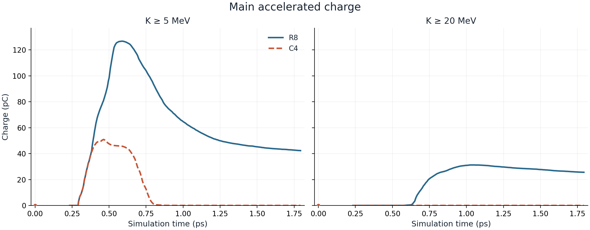
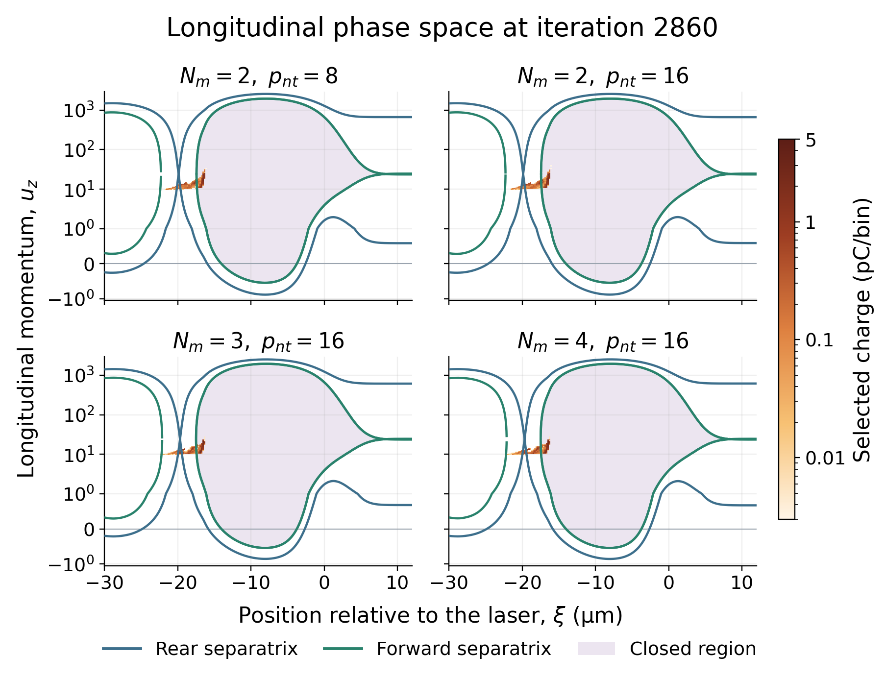

# Density downramp injection in laser wakefield acceleration

Oliver O’Reilly · MPhys Physics, Lancaster University

Does adding a short density downramp change electron capture and acceleration when compared with a uniform-density control run? I used FBPIC to compare an 8 µm density downramp (R8) with a constant-density control (C4). I then ran three additional R8 simulations to see how sensitive the wake evolution and electron beam properties were to azimuthal particle sampling and the number of retained azimuthal modes.

[Downramp comparison](#comparing-r8-and-c4) · [Convergence study](#testing-the-azimuthal-resolution) · [Redraw the figures](#redraw-the-published-figures) · [Run the simulations](#run-the-simulations)

## Repository layout

| Folder | Contents |
| --- | --- |
| [downramp-r8](downramp-r8/) | R8/C4 analysis and simulation code, saved plotting data, figures and archived run records |
| [r8-convergence](r8-convergence/) | Convergence analysis and simulation code, modal-error estimates and separatrix figures |
| [downramp-r8/data/downramp/settings](downramp-r8/data/downramp/settings/) | Definitions for the downramp diagnostics |
| [r8-convergence/results/settings](r8-convergence/results/settings/) | Saved convergence analysis settings, grouped by diagnostic |
| [r8-convergence/simulation/cases](r8-convergence/simulation/cases/) | FBPIC case inputs and their reference configurations |

Each study keeps its analysis scripts in `analysis/`, simulation launchers in `simulation/` and archived run records in `records/`. Original WSL runs can stay in `downramp-r8/downramp_comparison/` and `r8-convergence/runs/`. Git ignores those live run folders, along with checkpoints, regenerated output and ZIP archives.

## Comparing R8 and C4

R8 and C4 use the same laser and initial plateau density. R8 decreases from 4 × 10²⁴ to 3 × 10²⁴ m⁻³ over 8 µm, from z = 110 to 118 µm in the prescribed density profile. C4 stays on the upper plateau through that section. I compared the wake and longitudinal electric field at matching iterations, then looked at how the laser evolved and how much charge reached and sustained useful energy.

The initially chosen cutoff energy was 20 MeV, but essentially no charge was recorded above this threshold for C4. This led to the decision to include plots for electrons with at least 5 MeV and 20 MeV, which also tested the sensitivity to the chosen cutoff.

The main accelerated population uses saved forward electrons in the first complete wake period, between successive negative-to-positive crossings of the smoothed on-axis longitudinal electric field behind the laser. The tables label this selection `first_bucket`. Its compact subset, `first_bucket_compact`, lies within 2 µm of the axis. Reported beam moments require at least 20 effective macroparticles.

Taking the final snapshot, R8 retained 42.34 pC of charge above 5 MeV in the main accelerated electron population, with 25.62 pC retained above 20 MeV. The main advantage of R8 was the amount of charge it sustained at high energies. Between iterations 6000 and 10750, the fraction of R8 charge above 20 MeV within 2 µm of the axis fell from 93.2% to 0.80%. The divergence also increased late in the run.



### Assessing electron trapping

For the R8/C4 separatrix comparison, five electrons were selected from the highest-energy electrons in R8’s main accelerated population at the final snapshot, with a minimum longitudinal separation of 0.1 µm at iteration 2860. The corresponding C4 records were checked against the early R8 positions, momenta and weights. An asterisk in the legend marks an unavailable observation.

At iteration 2860, the five selected electrons in R8 lie inside the closed region of the instantaneous model. Their C4 counterparts lie outside it. The contours use the on-axis frozen Hamiltonian, zero transverse momentum, a measured cycle-averaged optical term and each run’s cold-plasma reference speed. Tracking the electrons relative to the evolving wake and its fields would provide a more direct test of sustained trapping. The [selection record](downramp-r8/data/downramp/separatrix/selection.json) gives the current model and the earlier model used for the selection cache.

| Figures | Location |
| --- | --- |
| Prescribed density and wake maps | [01_wake](downramp-r8/results/downramp/01_wake/) |
| Laser energy and spot radius | [02_laser](downramp-r8/results/downramp/02_laser/) |
| Beam and phase-space figures | [03_electrons](downramp-r8/results/downramp/03_electrons/) |
| Individual electron histories | [04_history](downramp-r8/results/downramp/04_history/) |
| Paired separatrices and close-ups | [05_separatrix](downramp-r8/results/downramp/05_separatrix/) |
| 5 and 20 MeV selections and longitudinal emittance | [06_sensitivity](downramp-r8/results/downramp/06_sensitivity/) |

Logbook Figures 2.2-10 and 2.2-11 show [charge](downramp-r8/results/downramp/06_sensitivity/charge.png) and [mean kinetic energy](downramp-r8/results/downramp/06_sensitivity/mean_energy.png). Figures 2.2-14 and 2.2-15 show the [near-axis charge fraction](downramp-r8/results/downramp/03_electrons/primary_beam/main_population_compact_fraction.png) and [R8 divergence](downramp-r8/results/downramp/06_sensitivity/divergence_R8.png).

## Testing the azimuthal resolution

I first increased pₙₜ from 8 to 16 at fixed Nₘ = 2, then compared Nₘ = 2, 3 and 4 at fixed pₙₜ = 16. The spatial grid, timestep, input laser, density profile and seed were kept fixed.

- Doubling the azimuthal particle sampling at Nₘ = 2 made little difference to the main accelerated charge. At iteration 10750, both runs retained approximately 25.6 pC above 20 MeV, with a mean energy of approximately 30.2 MeV.
- Increasing Nₘ from 2 to 3 had a more substantial effect. The final charge above 20 MeV fell from 25.60 to 21.91 pC, the mean energy fell from 30.2 to 29.7 MeV, and the normalised y-emittance fell from 3.49 to 1.84 mm mrad.
- Adding the fourth mode raised the charge slightly to 22.06 pC, and the mean energy stayed at 29.7 MeV to one decimal place. The maximum forward kinetic energy still showed a notable change, falling by 2.41 MeV.

I selected Nₘ = 3 and pₙₜ = 16 because the final values for accelerated charge, mean energy and energy spread agreed closely with the four-mode run. The particle-sampling test was performed at Nₘ = 2, so the effect of increasing pₙₜ at Nₘ = 3 remains unknown. The [quantitative comparison](r8-convergence/results/04_convergence/summary.md) records the full results.



The orange colour scale gives the charge per bin for K ≥ 5 MeV and u_z ≥ 1 in the main accelerated population. The blue and green curves show the rear and forward separatrices. Purple shading marks the closed region of the frozen on-axis model. Each panel uses its run’s longitudinal field and measured laser position. All four use the same bins, baseline R8 optical profile and reference speed β = 0.9991385. The [model summary](r8-convergence/results/06_separatrices/data/separatrix_summary.csv) records the saddle positions, limiting saddle, selected charge and largest numerical Hamiltonian residual.

### Choosing the iteration for the modal-error estimate

Near-axis charge decayed to nearly zero by the end of the run. The difference between three and four modes was larger than the difference between two and three modes at the final snapshot, even though the three- and four-mode curves had been close for much of the earlier evolution. The geometric series did not converge at the final snapshot for that quantity.

I therefore compared the three mode counts at the saved iteration where each quantity reached its maximum in the Nₘ = 3 run. The estimate assumes the successive changes decay geometrically at the observed ratio. It describes the error at the peak of the quantity, and the error itself could peak at another iteration.

| Convergence results | Location |
| --- | --- |
| Wake structure and field overlays | [01_wake](r8-convergence/results/01_wake/) |
| Laser evolution | [02_laser](r8-convergence/results/02_laser/) |
| Charge, energy, emittance and phase space | [03_electrons](r8-convergence/results/03_electrons/) |
| Sensitivity to the 5 and 20 MeV selections | [05_sensitivity_check](r8-convergence/results/05_sensitivity_check/) |
| Five separatrix snapshots | [06_separatrices](r8-convergence/results/06_separatrices/figures/) |
| Modal-error estimates | [Peak-based](r8-convergence/results/modal_error_table.png) and [final snapshot](r8-convergence/results/04_convergence/figures/modal_error_table_final.png) |

| Logbook figure | Plot |
| --- | --- |
| 2.4-2 | [Wake evolution](r8-convergence/results/01_wake/figures/wake_evolution.png) |
| 2.4-3 and 2.4-4 | [Charge evolution](r8-convergence/results/03_electrons/figures/charge.png) and [mean kinetic energy](r8-convergence/results/03_electrons/figures/mean_energy.png) |
| 2.4-6 and 2.4-7 | [Normalised emittance](r8-convergence/results/03_electrons/figures/emittance.png) and [energy spread](r8-convergence/results/03_electrons/figures/energy_spread.png) |
| 2.4-10 and 2.4-11 | [Separatrix at iteration 2860](r8-convergence/results/06_separatrices/figures/R8_Separatrices_02860.png) and [iteration 6000](r8-convergence/results/06_separatrices/figures/R8_Separatrices_06000.png) |

## Redraw the published figures

From the repository root, use Python 3.11 or newer. The plotting environment was checked on Python 3.12.

```bash
python3 -m venv .venv
source .venv/bin/activate
python -m pip install -r requirements-plot.txt
```

### R8/C4 figures

```bash
python downramp-r8/analysis/analysis.py --tables-only --output regenerated
python downramp-r8/analysis/analysis.py --separatrix-only --output regenerated
```

The first command redraws 34 figures from the [saved tables](downramp-r8/data/downramp/). The second redraws 25 separatrix figures from the [saved optical profiles and particle records](downramp-r8/data/downramp/separatrix/) at iterations 2860, 4000, 6000, 8000 and 10750. Both write to `regenerated/downramp/`. The saved separatrix panels retain their original layout.

The density profile illustration, combined origin plot and edited beam-selection panels are supplied as PNGs. Wake maps and longitudinal and transverse phase-space figures require the original openPMD diagnostics or rerun output.

### Convergence figures and modal-error tables

```bash
python r8-convergence/analysis/analyse_convergence.py --replot \
  --replot-from r8-convergence/results --output regenerated/convergence
python r8-convergence/analysis/separatrices/plot_separatrices.py \
  --output regenerated/convergence/06_separatrices

summary=r8-convergence/results/04_convergence/data/convergence_summary.csv
out=regenerated/convergence/04_convergence
mkdir -p "$out"

python r8-convergence/analysis/estimate_r8_modal_error.py "$summary" > "$out/modal_error_estimates.csv"
python r8-convergence/analysis/make_r8_modal_error_table.py \
  "$out/modal_error_estimates.csv" "$out/modal_error_table.png"
python r8-convergence/analysis/estimate_r8_modal_error.py --at final "$summary" > "$out/modal_error_estimates_final.csv"
python r8-convergence/analysis/make_r8_modal_error_table.py \
  "$out/modal_error_estimates_final.csv" "$out/modal_error_table_final.png"
```

The redraw commands use the included tables and snapshot arrays. The estimates use the archived convergence summary and matched differences. All convergence curves use the same saved times. The on-axis field overlays use a common moving coordinate tied to the input laser centre so changes in the location of wake features remain visible.

## Run the simulations

The original simulations used Python 3.11 and FBPIC 0.27.0 under Linux or WSL. See the [R8 environment record](downramp-r8/records/R8/run_environment.json) for the original versions. Install the simulation and HDF5 readers into an environment with the plotting dependencies.

```bash
python -m pip install 'fbpic==0.27.0' 'openPMD-viewer==1.7.0' 'h5py==3.16.0'
```

### R8 and C4

```bash
python -u downramp-r8/simulation/run_overnight.py --dry-run \
  --output-root regenerated/simulation/downramp-r8/downramp_comparison
```

Remove `--dry-run` to run R8 and then C4. Both take 10,800 steps. Allow space for raw particle histories, field diagnostics and checkpoints. Once the raw files are present, pass the parent of `downramp_comparison/` to the analysis.

```bash
python downramp-r8/analysis/analysis.py \
  --run-root regenerated/simulation/downramp-r8 \
  --output regenerated/raw-figures
```

Add `--raw-separatrix` to rebuild the optical inputs and C4 tracks from the original diagnostics. The [archived input](downramp-r8/records/archived_run_input.py) and [R8/C4 run records](downramp-r8/records/) document the original setup.

### Convergence cases

The reference is the R8 run with Nₘ = 2 and pₙₜ = 8 from the preceding comparison. Run the Nₘ = 2 and 3 cases at pₙₜ = 16 first. The fourth-mode launcher checks the completed three-mode case in the same output root.

```bash
project=regenerated/simulation/r8-convergence

python -u r8-convergence/simulation/run_r8_convergence.py --output-root "$project/runs"
python -u r8-convergence/simulation/run_r8_nm4.py --output-root "$project/runs"

python r8-convergence/analysis/analyse_convergence.py \
  --project "$project" \
  --baseline regenerated/simulation/downramp-r8/downramp_comparison/R8 \
  --output regenerated/raw-convergence
```

Use `--dry-run` to check the setup. The fourth-mode check requires the completed three-mode reference. The [convergence run records](r8-convergence/records/) keep the original input, configuration, environment and completion record for each case. Paths in the archived commands describe the original run layout.

The simulation inputs are adapted from the FBPIC LWFA example. The original inputs retain the upstream notice, also reproduced in the [FBPIC licence](licenses/FBPIC-LICENSE.txt).
